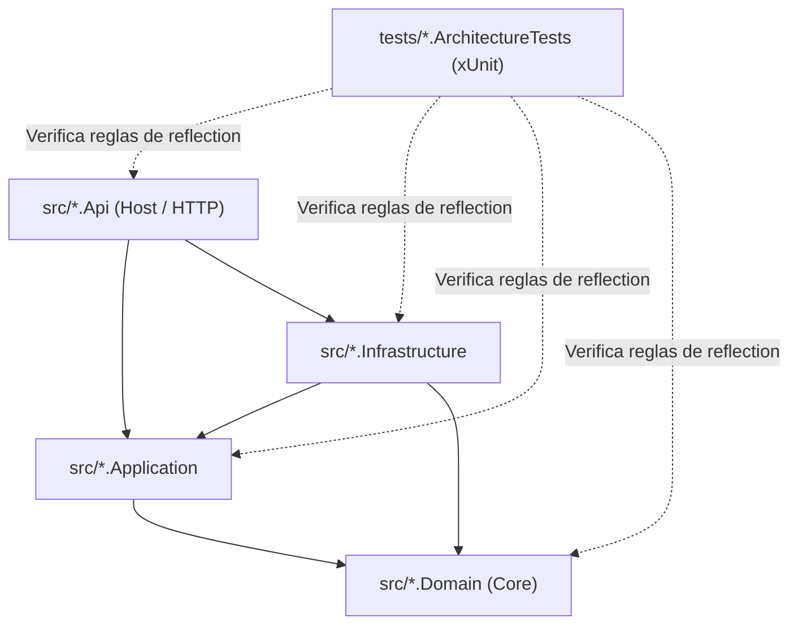

# Clean Architecture en .NET: Estructura, DI & Architecture Tests 🏗️🛡️

Guía prescriptiva para diseñar, construir y verificar proyectos en **.NET 8 / 9** bajo los principios de **Clean Architecture**, inversión de dependencias limpia, separación de interfaces e implementaciones, y pruebas automatizadas de arquitectura ("quién conoce a quién").

---

## 🏛️ 1. Matriz de Dependencias ("Quién Conoce a Quién")

El principio rector es la **Regla de Dependencias**: las dependencias en el código fuente solo pueden apuntar hacia adentro, hacia las capas de mayor nivel de abstracción.



### Tabla de Responsabilidades y Límites

| Capa / Proyecto | Tipo | Responsabilidad | Conoce a | PROHIBIDO Conocer a |
| :--- | :---: | :--- | :--- | :--- |
| **`Domain`** | `classlib` | Entidades ricas, Value Objects, Domain Events, Enums, Domain Errors, interfaces nucleares de agregados. | **A nadie** (Cero dependencias externas ni de otros proyectos). | `Application`, `Infrastructure`, `Api`, EF Core, librerías HTTP. |
| **`Application`** | `classlib` | Casos de uso (Commands/Queries con MediatR), DTOs, interfaces de contratos (`IRepository`, `IUnitOfWork`, `IEmailService`), validadores con FluentValidation (`*Validator.cs`). | `Domain` | `Infrastructure`, `Api`, `DbContext`, drivers SQL, HttpContext. |
| **`Infrastructure`** | `classlib` | Persistencia (EF Core `DbContext`, migraciones), repositorios concretos, adaptadores externos, clientes HTTP de terceros. | `Application`, `Domain` | `Api`, Controllers, HttpContext. |
| **`Api`** | `webapi` | Endpoints (Controllers o Minimal APIs), middlewares, autenticación/autorización, composición de DI (`Program.cs`). | `Application`, `Infrastructure` (solo para registrar DI) | No debe saltear `Application` para usar `DbContext` directo en endpoints. |
| **`ArchitectureTests`** | `xunit` | Pruebas de arquitectura con `NetArchTest.Rules` que fallan el build si alguien viola los límites de capas. | Todos los proyectos (solo para análisis de tipos). | No contiene código de producción. |

---

## 🚀 2. Scaffolding Rápido con .NET CLI

Comando integral para inicializar una solución limpia desde la terminal:

```bash
# 1. Crear solución
export PROJECT_NAME="MiEmpresa.MiModulo"
dotnet new sln -n $PROJECT_NAME

# 2. Crear capas en src/
dotnet new classlib -o src/$PROJECT_NAME.Domain -f net8.0
dotnet new classlib -o src/$PROJECT_NAME.Application -f net8.0
dotnet new classlib -o src/$PROJECT_NAME.Infrastructure -f net8.0
dotnet new webapi -o src/$PROJECT_NAME.Api -f net8.0 --no-openapi

# 3. Crear proyectos de test en tests/
dotnet new xunit -o tests/$PROJECT_NAME.ArchitectureTests -f net8.0
dotnet new xunit -o tests/$PROJECT_NAME.UnitTests -f net8.0

# 4. Agregar proyectos a la solución
dotnet sln add src/$PROJECT_NAME.Domain/$PROJECT_NAME.Domain.csproj
dotnet sln add src/$PROJECT_NAME.Application/$PROJECT_NAME.Application.csproj
dotnet sln add src/$PROJECT_NAME.Infrastructure/$PROJECT_NAME.Infrastructure.csproj
dotnet sln add src/$PROJECT_NAME.Api/$PROJECT_NAME.Api.csproj
dotnet sln add tests/$PROJECT_NAME.ArchitectureTests/$PROJECT_NAME.ArchitectureTests.csproj
dotnet sln add tests/$PROJECT_NAME.UnitTests/$PROJECT_NAME.UnitTests.csproj

# 5. Enlazar referencias de proyectos ("Quién conoce a quién")
# Application depende solo de Domain
dotnet add src/$PROJECT_NAME.Application reference src/$PROJECT_NAME.Domain

# Infrastructure depende de Application y Domain
dotnet add src/$PROJECT_NAME.Infrastructure reference src/$PROJECT_NAME.Application
dotnet add src/$PROJECT_NAME.Infrastructure reference src/$PROJECT_NAME.Domain

# Api depende de Application e Infrastructure (para Composition Root)
dotnet add src/$PROJECT_NAME.Api reference src/$PROJECT_NAME.Application
dotnet add src/$PROJECT_NAME.Api reference src/$PROJECT_NAME.Infrastructure

# ArchitectureTests referencia a todos para analizarlos vía Reflection
dotnet add tests/$PROJECT_NAME.ArchitectureTests reference src/$PROJECT_NAME.Domain
dotnet add tests/$PROJECT_NAME.ArchitectureTests reference src/$PROJECT_NAME.Application
dotnet add tests/$PROJECT_NAME.ArchitectureTests reference src/$PROJECT_NAME.Infrastructure
dotnet add tests/$PROJECT_NAME.ArchitectureTests reference src/$PROJECT_NAME.Api
```

### Paquetes NuGet Recomendados

```bash
# En Application:
dotnet add src/$PROJECT_NAME.Application package MediatR
dotnet add src/$PROJECT_NAME.Application package FluentValidation
dotnet add src/$PROJECT_NAME.Application package FluentValidation.DependencyInjectionExtensions

# En Infrastructure:
dotnet add src/$PROJECT_NAME.Infrastructure package Microsoft.EntityFrameworkCore
dotnet add src/$PROJECT_NAME.Infrastructure package Npgsql.EntityFrameworkCore.PostgreSQL # o Microsoft.EntityFrameworkCore.SqlServer

# En ArchitectureTests:
dotnet add tests/$PROJECT_NAME.ArchitectureTests package NetArchTest.Rules
dotnet add tests/$PROJECT_NAME.ArchitectureTests package FluentAssertions
```

---

## 📁 3. Estructura de Directorios Recomendada

```text
MiEmpresa.MiModulo/
├── src/
│   ├── MiEmpresa.MiModulo.Domain/
│   │   ├── Common/              # Entity.cs, ValueObject.cs, AggregateRoot.cs
│   │   ├── Users/               # User.cs, UserId.cs, UserRole.cs
│   │   └── Repositories/        # IUserRepository.cs (Interfaces en Core)
│   │
│   ├── MiEmpresa.MiModulo.Application/
│   │   ├── Common/
│   │   │   ├── Behaviors/       # ValidationBehavior.cs (Pipeline de MediatR)
│   │   │   └── Exceptions/      # ValidationException.cs
│   │   ├── Users/
│   │   │   ├── Commands/
│   │   │   │   ├── CreateUser/
│   │   │   │   │   ├── CreateUserCommand.cs
│   │   │   │   │   ├── CreateUserCommandHandler.cs
│   │   │   │   │   └── CreateUserCommandValidator.cs  <-- Validador exclusivo
│   │   │   └── Queries/
│   │   │       └── GetUserById/
│   │   │           ├── GetUserByIdQuery.cs
│   │   │           ├── GetUserByIdQueryHandler.cs
│   │   │           └── GetUserByIdQueryValidator.cs
│   │   └── DependencyInjection.cs
│   │
│   ├── MiEmpresa.MiModulo.Infrastructure/
│   │   ├── Persistence/
│   │   │   ├── AppDbContext.cs
│   │   │   ├── Configurations/  # UserConfiguration.cs (IEntityTypeConfiguration)
│   │   │   └── Repositories/    # UserRepository.cs (Implementación concreta)
│   │   └── DependencyInjection.cs
│   │
│   └── MiEmpresa.MiModulo.Api/
│       ├── Controllers/         # UsersController.cs (Inyecta únicamente ISender)
│       ├── Middlewares/         # ExceptionHandlingMiddleware.cs
│       └── Program.cs           # Composition Root mínimo
│
└── tests/
    └── MiEmpresa.MiModulo.ArchitectureTests/
        ├── LayerDependencyTests.cs
        ├── ControllerTests.cs
        ├── CommandAndQueryTests.cs
        └── ValidatorTests.cs
```

---

## 💉 4. Inyección de Dependencias Modular y Desacoplada

Nunca registres los servicios de `Application` ni de `Infrastructure` directamente en el `Program.cs`. Cada capa es dueña de su propio método de extensión `DependencyInjection.cs`.

### 4.1 Capa `Application`: Registro de MediatR y FluentValidation

```csharp
// src/MiEmpresa.MiModulo.Application/DependencyInjection.cs
using System.Reflection;
using FluentValidation;
using MediatR;
using Microsoft.Extensions.DependencyInjection;
using MiEmpresa.MiModulo.Application.Common.Behaviors;

namespace MiEmpresa.MiModulo.Application;

public static class DependencyInjection
{
    public static IServiceCollection AddApplication(this IServiceCollection services)
    {
        var assembly = Assembly.GetExecutingAssembly();

        // 1. Registrar MediatR y el Pipeline de Validación automático
        services.AddMediatR(cfg =>
        {
            cfg.RegisterServicesFromAssembly(assembly);
            cfg.AddBehavior(typeof(IPipelineBehavior<,>), typeof(ValidationBehavior<,>));
        });

        // 2. Registrar todos los validadores de FluentValidation del ensamblado
        services.AddValidatorsFromAssembly(assembly, includeInternalTypes: true);

        return services;
    }
}
```

### 4.2 Capa `Infrastructure`: Registro de Persistencia y Adaptadores

```csharp
// src/MiEmpresa.MiModulo.Infrastructure/DependencyInjection.cs
using Microsoft.EntityFrameworkCore;
using Microsoft.Extensions.Configuration;
using Microsoft.Extensions.DependencyInjection;
using MiEmpresa.MiModulo.Domain.Repositories;
using MiEmpresa.MiModulo.Infrastructure.Persistence;
using MiEmpresa.MiModulo.Infrastructure.Persistence.Repositories;

namespace MiEmpresa.MiModulo.Infrastructure;

public static class DependencyInjection
{
    public static IServiceCollection AddInfrastructure(
        this IServiceCollection services,
        IConfiguration configuration)
    {
        var connectionString = configuration.GetConnectionString("Database")
            ?? throw new InvalidOperationException("Connection string 'Database' not configured.");

        services.AddDbContext<AppDbContext>(options =>
            options.UseNpgsql(connectionString));

        // Inversión de dependencias: Interface en Domain/Application -> Implementación aquí
        services.AddScoped<IUserRepository, UserRepository>();

        return services;
    }
}
```

### 4.3 Capa `Api`: `Program.cs` Limpio (Composition Root)

```csharp
// src/MiEmpresa.MiModulo.Api/Program.cs
using MiEmpresa.MiModulo.Application;
using MiEmpresa.MiModulo.Infrastructure;

var builder = WebApplication.CreateBuilder(args);

// Composición limpia de módulos
builder.Services.AddApplication();
builder.Services.AddInfrastructure(builder.Configuration);

builder.Services.AddControllers();
builder.Services.AddEndpointsApiExplorer();

var app = builder.Build();

app.UseHttpsRedirection();
app.UseAuthorization();
app.MapControllers();

app.Run();
```

---

## ⚡ 5. FluentValidation con Pipeline Automático (`ValidationBehavior`)

Para garantizar que **ningún endpoint ejecute lógica de negocio si los datos son inválidos**, MediatR intercepta cada `IRequest` mediante un pipeline behavior.

### 5.1 El Pipeline Behavior

```csharp
// src/MiEmpresa.MiModulo.Application/Common/Behaviors/ValidationBehavior.cs
using FluentValidation;
using MediatR;

namespace MiEmpresa.MiModulo.Application.Common.Behaviors;

public sealed class ValidationBehavior<TRequest, TResponse>(
    IEnumerable<IValidator<TRequest>> validators)
    : IPipelineBehavior<TRequest, TResponse>
    where TRequest : IRequest<TResponse>
{
    public async Task<TResponse> Handle(
        TRequest request,
        RequestHandlerDelegate<TResponse> next,
        CancellationToken cancellationToken)
    {
        if (!validators.Any())
        {
            return await next();
        }

        var context = new ValidationContext<TRequest>(request);

        var validationResults = await Task.WhenAll(
            validators.Select(v => v.ValidateAsync(context, cancellationToken)));

        var failures = validationResults
            .SelectMany(r => r.Errors)
            .Where(f => f is not null)
            .ToList();

        if (failures.Count != 0)
        {
            throw new ValidationException(failures);
        }

        return await next();
    }
}
```

### 5.2 Validador en Archivo Exclusivo por Entidad / Comando

Cada comando o consulta posee su propio archivo dedicado heredando de `AbstractValidator<T>`:

```csharp
// src/MiEmpresa.MiModulo.Application/Users/Commands/CreateUser/CreateUserCommandValidator.cs
using FluentValidation;

namespace MiEmpresa.MiModulo.Application.Users.Commands.CreateUser;

public sealed class CreateUserCommandValidator : AbstractValidator<CreateUserCommand>
{
    public CreateUserCommandValidator()
    {
        RuleFor(x => x.Email)
            .NotEmpty().WithMessage("El email no puede estar vacío.")
            .EmailAddress().WithMessage("El email debe tener un formato válido.")
            .MaximumLength(255).WithMessage("El email no puede superar los 255 caracteres.");

        RuleFor(x => x.FirstName)
            .NotEmpty().WithMessage("El nombre es obligatorio.")
            .MaximumLength(100).WithMessage("El nombre no puede superar los 100 caracteres.");

        RuleFor(x => x.LastName)
            .NotEmpty().WithMessage("El apellido es obligatorio.")
            .MaximumLength(100).WithMessage("El apellido no puede superar los 100 caracteres.");
    }
}
```

### 5.3 Controlador Delgado (Solo inyecta `ISender`)

```csharp
// src/MiEmpresa.MiModulo.Api/Controllers/UsersController.cs
using MediatR;
using Microsoft.AspNetCore.Mvc;
using MiEmpresa.MiModulo.Application.Users.Commands.CreateUser;
using MiEmpresa.MiModulo.Application.Users.Queries.GetUserById;

namespace MiEmpresa.MiModulo.Api.Controllers;

[ApiController]
[Route("api/[controller]")]
public sealed class UsersController(ISender sender) : ControllerBase
{
    [HttpPost]
    public async Task<IActionResult> Create(
        [FromBody] CreateUserCommand command,
        CancellationToken cancellationToken)
    {
        var userId = await sender.Send(command, cancellationToken);
        return CreatedAtAction(nameof(GetById), new { id = userId }, userId);
    }

    [HttpGet("{id:guid}")]
    public async Task<IActionResult> GetById(
        Guid id,
        CancellationToken cancellationToken)
    {
        var user = await sender.Send(new GetUserByIdQuery(id), cancellationToken);
        return user is not null ? Ok(user) : NotFound();
    }
}
```

---

## 🧪 6. Suite Completa de Architecture Tests con xUnit ("Quién Conoce a Quién")

Estas pruebas se ejecutan en cada `dotnet test` y fallan inmediatamente si algún desarrollador agrega una referencia prohibida o viola las convenciones de Clean Architecture.

### 6.1 Reglas de Capas: `LayerDependencyTests.cs`

```csharp
// tests/MiEmpresa.MiModulo.ArchitectureTests/LayerDependencyTests.cs
using System.Reflection;
using FluentAssertions;
using NetArchTest.Rules;
using Xunit;

namespace MiEmpresa.MiModulo.ArchitectureTests;

public class LayerDependencyTests
{
    private static readonly Assembly DomainAssembly = typeof(Domain.Common.Entity).Assembly;
    private static readonly Assembly ApplicationAssembly = typeof(Application.DependencyInjection).Assembly;
    private static readonly Assembly InfrastructureAssembly = typeof(Infrastructure.DependencyInjection).Assembly;
    private static readonly Assembly ApiAssembly = typeof(Api.Controllers.UsersController).Assembly;

    private const string DomainNamespace = "MiEmpresa.MiModulo.Domain";
    private const string ApplicationNamespace = "MiEmpresa.MiModulo.Application";
    private const string InfrastructureNamespace = "MiEmpresa.MiModulo.Infrastructure";
    private const string ApiNamespace = "MiEmpresa.MiModulo.Api";

    [Fact]
    public void Domain_Should_Not_HaveDependencyOn_OtherProjects()
    {
        // El núcleo de Dominio NUNCA debe conocer a Application, Infrastructure ni Api
        var testResult = Types.InAssembly(DomainAssembly)
            .ShouldNot()
            .HaveDependencyOnAny(ApplicationNamespace, InfrastructureNamespace, ApiNamespace)
            .GetResult();

        testResult.IsSuccessful.Should().BeTrue("el Dominio no puede depender de capas externas");
    }

    [Fact]
    public void Application_Should_Not_HaveDependencyOn_InfrastructureOrApi()
    {
        // Application solo conoce a Domain; NUNCA a Infrastructure ni Api
        var testResult = Types.InAssembly(ApplicationAssembly)
            .ShouldNot()
            .HaveDependencyOnAny(InfrastructureNamespace, ApiNamespace)
            .GetResult();

        testResult.IsSuccessful.Should().BeTrue("Application no puede depender de Infrastructure ni Api");
    }

    [Fact]
    public void Infrastructure_Should_Not_HaveDependencyOn_Api()
    {
        // Infrastructure implementa contratos pero NUNCA conoce la capa de presentación Web
        var testResult = Types.InAssembly(InfrastructureAssembly)
            .ShouldNot()
            .HaveDependencyOn(ApiNamespace)
            .GetResult();

        testResult.IsSuccessful.Should().BeTrue("Infrastructure no puede depender de la Api");
    }
}
```

### 6.2 Reglas de Controladores y Abstracciones: `ControllerTests.cs`

```csharp
// tests/MiEmpresa.MiModulo.ArchitectureTests/ControllerTests.cs
using System.Reflection;
using FluentAssertions;
using Microsoft.AspNetCore.Mvc;
using NetArchTest.Rules;
using Xunit;

namespace MiEmpresa.MiModulo.ArchitectureTests;

public class ControllerTests
{
    private static readonly Assembly ApiAssembly = typeof(Api.Controllers.UsersController).Assembly;
    private const string InfrastructureNamespace = "MiEmpresa.MiModulo.Infrastructure";

    [Fact]
    public void Controllers_Should_InheritFrom_ControllerBase()
    {
        var testResult = Types.InAssembly(ApiAssembly)
            .That()
            .HaveNameEndingWith("Controller")
            .Should()
            .Inherit(typeof(ControllerBase))
            .GetResult();

        testResult.IsSuccessful.Should().BeTrue("todos los controladores deben heredar de ControllerBase");
    }

    [Fact]
    public void Controllers_Should_Not_DirectlyDependOn_Infrastructure()
    {
        // Los controladores se comunican exclusivamente vía Application (ISender), nunca invocan Infrastructure
        var testResult = Types.InAssembly(ApiAssembly)
            .That()
            .HaveNameEndingWith("Controller")
            .ShouldNot()
            .HaveDependencyOn(InfrastructureNamespace)
            .GetResult();

        testResult.IsSuccessful.Should().BeTrue("los controladores deben comunicarse a través de Application y no usar Infrastructure directamente");
    }
}
```

### 6.3 Convenciones de Handlers y Validadores: `ConventionTests.cs`

```csharp
// tests/MiEmpresa.MiModulo.ArchitectureTests/ConventionTests.cs
using System.Reflection;
using FluentAssertions;
using FluentValidation;
using MediatR;
using NetArchTest.Rules;
using Xunit;

namespace MiEmpresa.MiModulo.ArchitectureTests;

public class ConventionTests
{
    private static readonly Assembly ApplicationAssembly = typeof(Application.DependencyInjection).Assembly;

    [Fact]
    public void CommandHandlers_Should_HaveSuffix_CommandHandler()
    {
        var testResult = Types.InAssembly(ApplicationAssembly)
            .That()
            .ImplementInterface(typeof(IRequestHandler<,>))
            .And()
            .HaveNameEndingWith("CommandHandler")
            .Should()
            .BeClasses()
            .GetResult();

        testResult.IsSuccessful.Should().BeTrue();
    }

    [Fact]
    public void Validators_Should_InheritFrom_AbstractValidator_And_HaveValidatorSuffix()
    {
        // Garantiza que cada validador termine con el sufijo 'Validator' y herede de AbstractValidator<T>
        var testResult = Types.InAssembly(ApplicationAssembly)
            .That()
            .HaveNameEndingWith("Validator")
            .Should()
            .Inherit(typeof(AbstractValidator<>))
            .GetResult();

        testResult.IsSuccessful.Should().BeTrue("todo validador debe heredar de AbstractValidator<T>");
    }

    [Fact]
    public void DomainInterfaces_Should_StartWith_I()
    {
        var domainAssembly = typeof(Domain.Common.Entity).Assembly;

        var testResult = Types.InAssembly(domainAssembly)
            .That()
            .AreInterfaces()
            .Should()
            .HaveNameStartingWith("I")
            .GetResult();

        testResult.IsSuccessful.Should().BeTrue("toda interfaz en Domain debe comenzar con 'I'");
    }
}
```

---

## ⚙️ 7. Higiene de MSBuild de la Solución

Ubica estos archivos en la raíz del repositorio para garantizar compilaciones estrictas y seguras en todos los proyectos:

### `Directory.Build.props` (Configuración Unificada)

```xml
<Project>
  <PropertyGroup>
    <TargetFramework>net8.0</TargetFramework>
    <Nullable>enable</Nullable>
    <ImplicitUsings>enable</ImplicitUsings>
    <TreatWarningsAsErrors>true</TreatWarningsAsErrors>
    <AnalysisLevel>latest-recommended</AnalysisLevel>
    <EnforceCodeStyleInBuild>true</EnforceCodeStyleInBuild>
  </PropertyGroup>
</Project>
```

---

## 📋 Checklist de Verificación para Nuevos Proyectos

- [ ] La solución cuenta con las 4 capas principales (`Domain`, `Application`, `Infrastructure`, `Api`).
- [ ] La capa `Domain` no referencia ningún paquete externo ni otros proyectos de la solución.
- [ ] La capa `Application` solo referencia a `Domain`.
- [ ] Cada validación reside en un archivo `*Validator.cs` exclusivo por entidad/comando con `AbstractValidator<T>`.
- [ ] `ValidationBehavior` está registrado en el pipeline de MediatR para validar automáticamente todas las solicitudes.
- [ ] Los controladores inyectan `ISender` en lugar del contenedor entero `IMediator` o `DbContext`.
- [ ] La suite `ArchitectureTests` con xUnit y `NetArchTest.Rules` corre en verde en cada `dotnet test`.
