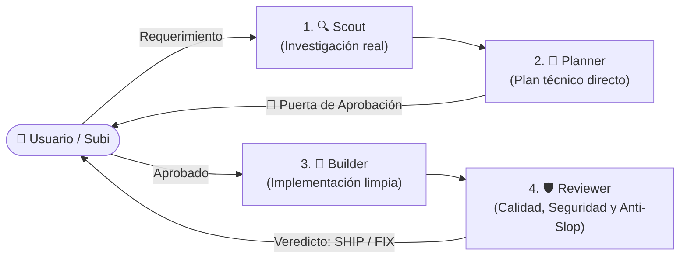

# Agent Pipeline: Flujo de Desarrollo Colaborativo Ágil 🚀

Protocolo de ingeniería para desarrollo de features, mejoras y refactors basado en una **tubería secuencial de agentes especializados**, eliminando la burocracia de plantillas y archivos Markdown en el repositorio.

---

## 🎯 Principios Fundamentales

1. **Cero Burocracia Documental**: Prohibido crear archivos temporales de spec, tareas o planes en el repositorio (`.specs/`, `tasks.md`, etc.). Toda la coordinación técnica se mantiene en el contexto conversacional o en artefactos interactivos.
2. **Especialización de Roles**: Cada etapa del pipeline la ejecuta un rol con una única responsabilidad clara.
3. **Puerta de Aprobación Única (Plan Gate)**: La implementación solo inicia una vez que el usuario valida el plan propuesto.
4. **Mínima Invasión**: El código se modifica de forma quirúrgica; sin reescrituras innecesarias ni código muerto.

---

## 🔄 Las 4 Etapas del Pipeline

---

### 1. 🔍 Etapa 1: Scout (Exploración del Repositorio)

* **Rol**: Investigador / Relevador de contexto (`research`).
* **Objetivo**: Conocer la realidad del código antes de diseñar o proponer soluciones.
* **Acciones Obligatorias**:
  - Localizar archivos, rutas, modelos y puntos de entrada involucrados.
  - Verificar librerías instaladas y versiones (sin asumir supuestos).
  - Identificar contratos existentes, tipos y dependencias directas.
* **Regla Innegociable**: Prohibido proponer o modificar código en esta fase. Solo recolectar hechos comprobables.

---

### 2. 📐 Etapa 2: Planner (Planificación Técnica)

* **Rol**: Arquitecto de Software (`architect` o Agente Principal).
* **Objetivo**: Diseñar una solución técnica directa, limpia y libre de complejidad accidental.
* **Formato del Plan (Conciso y Accionable)**:
  - **Archivos a intervenir**: Lista exacta de archivos a crear o modificar.
  - **Estrategia de cambio**: Cómo se resuelve la necesidad en 3 a 5 viñetas directas.
  - **Riesgos y Edge Cases**: Puntos críticos a cuidar (concurrencia, nulos, validaciones).
* **🚪 Puerta de Aprobación**: Presentar el plan al usuario y esperar su confirmación explícita antes de tocar cualquier archivo.

---

### 3. 🔨 Etapa 3: Builder (Implementación Quirúrgica)

* **Rol**: Desarrollador Implementador (`fullstack-developer`).
* **Objetivo**: Traducir el plan técnico aprobado en código de producción limpio y funcional.
* **Reglas de Ejecución**:
  - **Cambios Quirúrgicos**: Modificar únicamente las líneas y bloques necesarios.
  - **Tipado Estricto**: Cero uso de `any` injustificado, respeto estricto de tipos nulos y schemas.
  - **Preservación de Contexto**: Mantener comentarios existentes, estructura del proyecto y convenciones del repo.

---

### 4. 🛡️ Etapa 4: Reviewer (Auditoría de Calidad y Anti-Slop)

* **Rol**: Auditor de Calidad (`code-reviewer`).
* **Objetivo**: Evaluación adversaria del código implementado sobre **5 criterios específicos**:

| Criterio | Qué se audita | Veredicto si falla |
| :--- | :--- | :--- |
| 🔒 **1. Seguridad** | Inyecciones (SQL/XSS), validación en bordes, sanitización, exposición de secretos, auth y permisos (RLS). | Bloqueante |
| 🧼 **2. Mantenibilidad** | Código limpio, nombres expresivos, responsabilidades claras (*Deep Modules*), modularidad y legibilidad sin hacks. | Bloqueante |
| 🧹 **3. Anti-Slop / Anti-Relleno** | **Erradicación del relleno de IA**: eliminar comentarios obvios o redundantes, funciones wrapper innecesarias, código muerto o sobreingeniería. | Bloqueante |
| ⚡ **4. Performance** | Consultas optimizadas, prevención de N+1, operaciones asíncronas no bloqueantes, control de asignaciones de memoria innecesarias. | Bloqueante |
| 📏 **5. Linting y Tests** | Linters sin errores ni warnings residuales, formateo uniforme, suite de pruebas ejecutada y en verde. | Bloqueante |

#### Veredicto de la Auditoría:
* **`SHIP`** ✅: Todos los 5 criterios aprobados. Listo para commit semántico y entrega.
* **`FIX`** ⚠️: Observaciones detectadas. El auditor lista los puntos puntuales a corregir y devuelve el control al Builder para un ajuste quirúrgico antes de re-evaluar.
