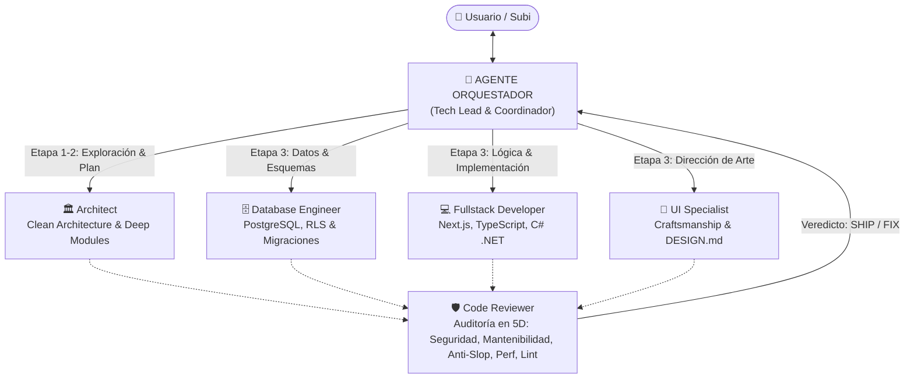

# Catálogo de Skills de Ingeniería de Software para Agentes de IA 🧠🛠️

Repositorio central y portable de **Skills operativas, Roles de Agentes y Reglas de Ingeniería de Software de alta fidelidad** para asistentes de desarrollo impulsados por Inteligencia Artificial (**Google Antigravity**, **Claude Code**, **Cursor**, **Windsurf** y entornos compatibles con el estándar `.agents/`).

Diseñado bajo la premisa de **Real Engineering & Craftsmanship vs AI Slop**: erradicar el código genérico, superficial y frágil mediante especificaciones estrictas, módulos profundos (*Deep Modules*), costuras de aislamiento (*Seams*), diagnóstico científico de bugs (loops en ROJO/VERDE) y contratos visuales deterministas (`DESIGN.md`).

---

## 📑 Tabla de Contenidos

- [Filosofía y Principios](#-filosofía-y-principios)
- [Catálogo de Skills (10 Disciplinas)](#-catálogo-de-skills-10-disciplinas)
- [Arquitectura de Agentes y Subagentes](#-arquitectura-de-agentes-y-subagentes)
- [Reglas y Convenciones de Ingeniería (`rules/`)](#-reglas-y-convenciones-de-ingeniería-rules)
- [Métodos de Instalación y Consumo](#-métodos-de-instalación-y-consumo)
  - [Opción 1: Enlace Simbólico (Symlink - Recomendado para desarrollo local)](#opción-1-enlace-simbólico-symlink---recomendado-para-desarrollo-local)
  - [Opción 2: Copia directa al proyecto (`.agents/skills/`)](#opción-2-copia-directa-al-proyecto-agentsskills)
  - [Opción 3: Submódulo Git](#opción-3-submódulo-git)
  - [Opción 4: Integración por Herramienta (Antigravity, Claude Code, Cursor)](#opción-4-integración-por-herramienta)
- [Estructura del Repositorio](#-estructura-del-repositorio)

---

## 🎯 Filosofía y Principios

1. **Agent Pipeline & Cero Burocracia**: Desarrollo colaborativo y ágil en 4 etapas (Scout → Planner → Builder → Reviewer). Cero archivos de plantillas innecesarios en el repo; máxima velocidad con control implacable de calidad.
2. **Deep Modules & Seams (John Ousterhout & Michael Feathers)**: Módulos con gran leverage que ocultan su complejidad interna detrás de interfaces simples y costuras limpias para pruebas deterministas sin mocks frágiles.
3. **Diagnóstico Científico & Tight Loops**: Ante bugs o regresiones, es obligatorio reproducir el fallo en un test unitario o traza ejecutable (ROJO) antes de aplicar el cambio quirúrgico que lo pase a VERDE.
4. **Frontend Craftsmanship & Anti-Slop**: Erradicación del "AI frontend monoculture" mediante 4 Modos de Visitante (*Persuade*, *Operate*, *Read*, *Experience*), piso de calidad (*Craft Floor*), paletas perceptuales `OKLCH` y escala tipográfica fluida con `clamp()`.
5. **UI Hardening en 5 Dimensiones**: Blindaje de interfaces contra datos extremos del mundo real: desbordamiento de texto, i18n, los 4 estados canónicos de UI (vacío, carga, error, poblado) y skeletons con zero CLS (Cumulative Layout Shift).

---

## 🧰 Catálogo de Skills (10 Disciplinas)

El directorio `skills/` contiene 10 especificaciones operativas empaquetadas según el estándar `SKILL.md` (con frontmatter YAML que incluye `name` y `description`).

| Skill | Propósito | Cuándo Utilizarla | Plantillas / Recursos |
| :--- | :--- | :--- | :--- |
| **`agent-pipeline`** | Pipeline ágil en 4 etapas (Scout → Planner → Builder → Reviewer) con control de seguridad, performance, linting y anti-slop. | Al diseñar e implementar nuevas features, refactors o mejoras sin sobrecarga documental. | Protocolo de ejecución en `SKILL.md` |
| **`codebase-design`** | Principios de diseño de software: *Deep Modules*, ocultamiento de información, *Seams* de I/O y la técnica *Design It Twice*. | Al diseñar nuevas interfaces, abstraer librerías, estructurar paquetes o desacoplar dependencias. | Guía y principios de diseño en `SKILL.md` |
| **`domain-modeling`** | Construcción y refinamiento continuo del modelo de dominio, lenguaje ubicuo y registro de decisiones de arquitectura (ADRs). | Al clarificar conceptos de negocio, crear o sincronizar `CONTEXT.md` y documentar ADRs en `docs/adr/`. | Guía de ADR y modelado en `SKILL.md` |
| **`diagnosing-bugs`** | Protocolo científico de depuración en 4 fases; **prohibido modificar código sin un Tight Feedback Loop en ROJO**. | Ante bugs difíciles, regresiones, excepciones inesperadas, timeouts o fallos intermitentes. | Protocolo de reproducción reproducible |
| **`fast-fix`** | Flujo ágil y científico para corregir errores puntuales en 1 o 2 archivos sin el overhead documental de SDD. | Para parches rápidos, fixes de sintaxis o tests fallidos puntuales: Test (ROJO) → Fix → Test (VERDE) → Commit. | Ciclo de ejecución rápida |
| **`ui-hardening-audit`** | Auditoría en 5 dimensiones (A11y WCAG AA, Rendimiento, Theming, Responsive e Integridad) y protocolo pre-entrega. | Antes de entregar o enviar a producción cualquier interfaz web o componente frontend. | Checklist de auditoría 5D y Polish Pre-Ship |
| **`dotnet-hardening`** | Optimización de alto rendimiento en C#, consultas sargables en EF Core, asincronía segura (Zero Sync-over-Async) y memoria. | En proyectos .NET ante consultas lentas, problemas de ThreadPool/GC, migraciones EF Core o higiene MSBuild. | Guía prescriptiva de rendimiento |
| **`wait-what`** | Comando de freno de mano y re-enfoque inmediato cuando la IA se vuelve verbosa, asume supuestos o pierde claridad. | Siempre que el agente se sobrecomplique o se desvíe; pausa la ejecución y resume en 3 viñetas concisas. | Mecanismo de re-alineamiento |
| **`wayfinder`** | Planificación y cartografía de iniciativas masivas (Epics) que superan el contexto de una sola sesión de IA. | Cuando un proyecto requiere más de 100k tokens o varios días de trabajo mediante mapas de decisiones y grafos. | Mapa de dependencias y tickets atómicos |

---

## 👥 Arquitectura de Agentes y Subagentes

El catálogo incluye definiciones de roles complementarios en `agents/` (y en `.agents/agents/`) para coordinar equipos de IA especializados bajo un modelo de orquestación jerárquica:



| Rol de Agente | Tipo | Responsabilidad Principal | Skills Asociadas |
| :--- | :---: | :--- | :--- |
| **`orchestrator`** | **Coordinador** | Tech Lead e interfaz principal con el usuario; gestiona el pipeline colaborativo, hace routing de tareas y valida puertas de aprobación. | `agent-pipeline`, `fast-fix`, `diagnosing-bugs`, `domain-modeling`, `codebase-design`, `ui-hardening-audit`, `wait-what`, `wayfinder` |
| **`architect`** | Subagente | Lidera las etapas Scout & Planner: investiga dependencias, diseña la solución sin sobrecarga documental y aplica Deep Modules. | `domain-modeling`, `codebase-design`, `agent-pipeline`, `wayfinder` |
| **`fullstack-developer`** | Subagente | Implementación estricta de código de producción (Builder), endpoints, componentes, TDD y feedback loops. | `agent-pipeline`, `diagnosing-bugs`, `codebase-design`, `dotnet-hardening` |
| **`database-engineer`** | Subagente | Diseño de esquemas relacionales, políticas RLS en Supabase, migraciones SQL reproducibles y queries EF Core. | `dotnet-hardening` |
| **`ui-specialist`** | Subagente | Especialista de interfaz frontend, accesibilidad WCAG AA y blindaje de componentes. | `ui-hardening-audit` |
| **`code-reviewer`** | Subagente | Auditoría adversaria de código (Reviewer): Seguridad, Mantenibilidad, Anti-Slop, Performance y Linting (`SHIP` / `FIX`). | `agent-pipeline`, `codebase-design`, `domain-modeling`, `diagnosing-bugs`, `ui-hardening-audit` |

---

## 📋 Reglas y Convenciones de Ingeniería (`rules/`)

El directorio `rules/` consolida directrices modulares agrupadas por dominio técnico:

### 1. `core/`
- **`agent-behavior.md`**: Directrices de comunicación concisa, uso del término ubicuo (`CONTEXT.md`), token canario de atención ("Subi") y protocolo científico ante bugs.
- **`clean-code.md`**: Principios de John Ousterhout (*Deep Modules*, *Information Hiding*), Michael Feathers (*Seams*), *Design It Twice*, KISS y manejo defensivo.
- **`git-conventions.md`**: Formato de Conventional Commits (`feat`, `fix`, `refactor`, etc.), commits atómicos y exclusiones estrictas de `.codegraph/` y variables `.env`.
- **`mcp-guidelines.md`**: Protocolos para consumo de servidores MCP: Context7 (documentación oficial), CodeGraph (análisis estructural) y Engram (memoria persistente).
- **`orchestrator-role.md`**: Definición exhaustiva del rol del Agente Orquestador, ciclo de vida SDD y protocolo de delegación.
- **`task-routing.md`**: Matriz de enrutamiento para canalizar tareas a los subagentes correctos según su naturaleza.

### 2. `backend/`
- **`dotnet-csharp.md`**: Clean Architecture, DDD, C# moderno (inmutabilidad, Result pattern), zero Sync-over-Async y EF Core sin N+1.
- **`node-apis.md`**: Diseño de APIs REST y Route Handlers, validación rigurosa con Zod, formato estándar de respuesta y manejo de errores.
- **`supabase-sql.md`**: Estándares de PostgreSQL, RLS obligatorio en todas las tablas públicas, migraciones versionadas y tipado estricto.

### 3. `frontend/`
- **`react-nextjs.md`**: Arquitectura de componentes, App Router, Server vs Client Components, manejo de los 4 estados de interfaz y zero-CLS.
- **`tailwind-css.md`**: Sistema de diseño basado en tokens semánticos, paletas OKLCH, prevención de AI-slop y tipografía responsiva fluida.
- **`typescript.md`**: Tipado estricto (`strict: true`), prohibición de `any` no justificado, discriminated unions e inmutabilidad con `readonly`.

---

## 🚀 Métodos de Instalación y Consumo

Puedes consumir este catálogo en cualquier repositorio o proyecto de desarrollo utilizando cualquiera de las siguientes estrategias:

### Opción 1: Enlace Simbólico (Symlink - Recomendado para desarrollo local)
Permite que todos tus proyectos locales consuman las skills actualizadas en tiempo real directamente desde este repositorio central:

```bash
# En el directorio raíz de tu proyecto destino:
mkdir -p .agents

# Vincular el catálogo completo de skills:
ln -s /ruta/absoluta/a/subi-kit-desarrollo/skills .agents/skills

# Opcional: vincular también agentes y reglas:
ln -s /ruta/absoluta/a/subi-kit-desarrollo/agents .agents/agents
ln -s /ruta/absoluta/a/subi-kit-desarrollo/rules .agents/rules
```

En **Windows (PowerShell ejecutado como Administrador)**:
```powershell
New-Item -ItemType SymbolicLink -Path ".agents\skills" -Target "C:\ruta\a\subi-kit-desarrollo\skills"
```

---

### Opción 2: Copia directa al proyecto (`.agents/skills/`)
Si prefieres que tu repositorio sea 100% autocontenido y versionar las skills junto con tu código fuente:

```bash
# En tu proyecto de destino:
mkdir -p .agents/skills

# Copiar todas las skills (incluyendo plantillas):
cp -r /ruta/a/subi-kit-desarrollo/skills/* .agents/skills/

# O seleccionar únicamente las skills deseadas:
cp -r /ruta/a/subi-kit-desarrollo/skills/agent-pipeline .agents/skills/
cp -r /ruta/a/subi-kit-desarrollo/skills/ui-hardening-audit .agents/skills/
```

---

### Opción 3: Submódulo Git
Para proyectos que deseen fijar una versión específica del catálogo y actualizarla mediante commits de Git:

```bash
git submodule add https://github.com/santi-subidia/subi-kit-desarrollo.git .subikit
mkdir -p .agents
ln -s ../.subikit/skills .agents/skills
```

---

### Opción 4: Integración por Herramienta

#### 1. Google Antigravity (Gemini CLI / AGY)
- **Local al proyecto**: Coloca las carpetas en `.agents/skills/`, `.agents/agents/` y `.agents/rules/`. Antigravity las detecta y activa de forma nativa.
- **Global para tu usuario**: Puedes enlazar o copiar las skills al directorio global de usuario de Antigravity:
  ```bash
  mkdir -p ~/.gemini/antigravity-cli/skills
  cp -r /ruta/a/subi-kit-desarrollo/skills/* ~/.gemini/antigravity-cli/skills/
  ```

#### 2. Claude Code
Agrega la referencia al catálogo o a las directrices principales en tu archivo `CLAUDE.md`:
```markdown
## Skills y Protocolos de Ingeniería
Este proyecto adopta las skills de ingeniería de software ubicadas en `.agents/skills/`:
- Para nuevas features y refactors: Seguir `.agents/skills/agent-pipeline/SKILL.md`
- Para resolución de bugs: Seguir `.agents/skills/diagnosing-bugs/SKILL.md`
- Para auditoría de interfaz: Seguir `.agents/skills/ui-hardening-audit/SKILL.md`
```

#### 3. Cursor & Windsurf
- Agrega las reglas a `.cursorrules` o dentro del directorio `.cursor/rules/`:
  ```bash
  mkdir -p .cursor/rules
  cp rules/core/*.md .cursor/rules/
  cp rules/frontend/*.md .cursor/rules/
  ```

---

## 📂 Estructura del Repositorio

```text
subi-kit-desarrollo/
├── .agents/                        # Estructura local lista para consumo
│   ├── agents/                     # Perfiles de agentes nativos
│   ├── rules/                      # Reglas locales sincronizadas
│   └── skills/                     # Skills locales con templates sincronizados
├── agents/                         # Catálogo de agentes y subagentes
│   ├── orchestrator.md             # Perfil del Agente Orquestador (Tech Lead)
│   └── subagents/                  # architect, code-reviewer, fullstack, etc.
├── rules/                          # Catálogo de reglas modularizadas
│   ├── backend/                    # dotnet-csharp, node-apis, supabase-sql
│   ├── core/                       # agent-behavior, clean-code, git-conventions...
│   └── frontend/                   # react-nextjs, tailwind-css, typescript
├── skills/                         # CATÁLOGO PRINCIPAL DE SKILLS (9)
│   ├── agent-pipeline/             # Pipeline ágil de 4 etapas (Scout, Planner, Builder, Reviewer)
│   ├── codebase-design/            # Deep Modules, Seams, Design It Twice
│   ├── diagnosing-bugs/            # Diagnóstico científico & feedback loops
│   ├── domain-modeling/            # Glosario ubicuo & ADRs
│   ├── dotnet-hardening/           # Rendimiento .NET, EF Core & MSBuild
│   ├── fast-fix/                   # Protocolo ágil de corrección de bugs
│   ├── ui-hardening-audit/         # Auditoría 5D de calidad de UI
│   ├── wait-what/                  # Freno de mano y rescate explicativo
│   └── wayfinder/                  # Epics y mapas de decisión
├── .gitignore                      # Exclusiones estrictas (.codegraph/, .env*, caches)
├── AGENTS.md                       # Directrices consolidadas del proyecto
└── README.md                       # Documentación oficial del catálogo
```

---

## 📄 Licencia

Distribuido bajo la licencia MIT. Eres libre de utilizar, adaptar e integrar este catálogo en cualquier proyecto personal o comercial.
